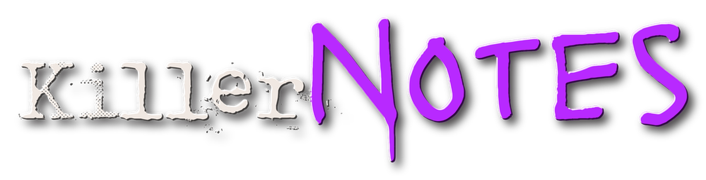
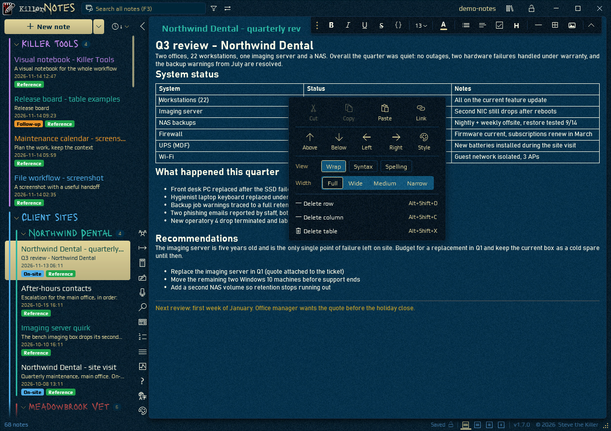
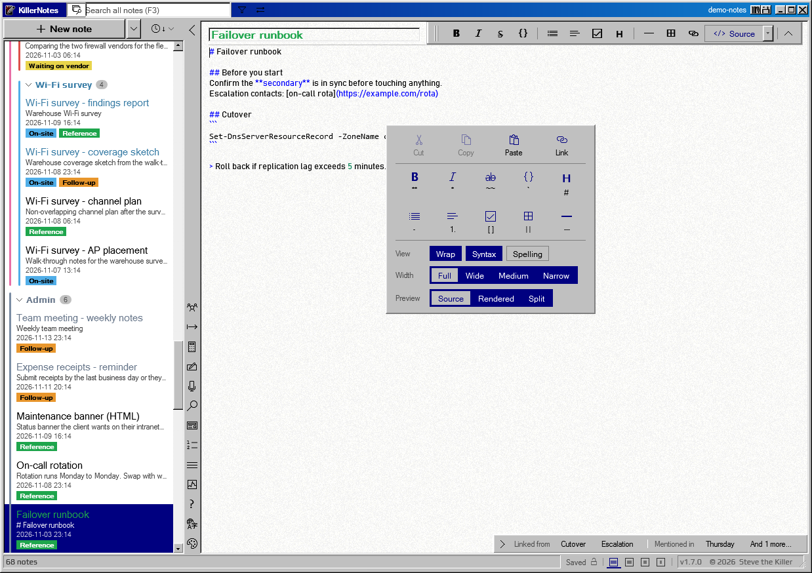
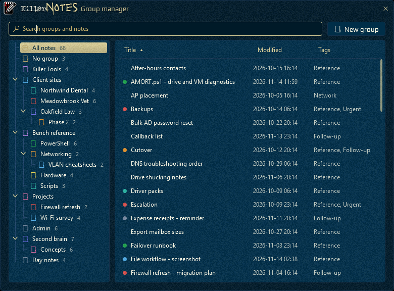
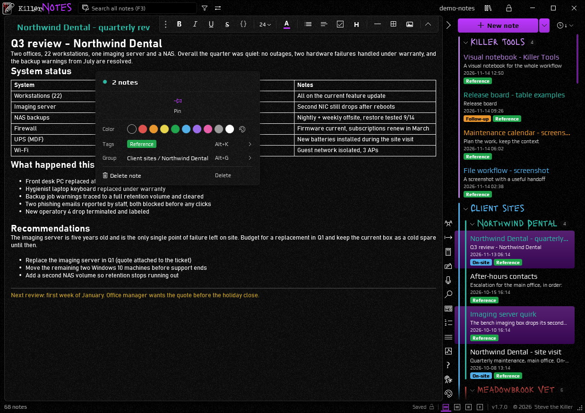
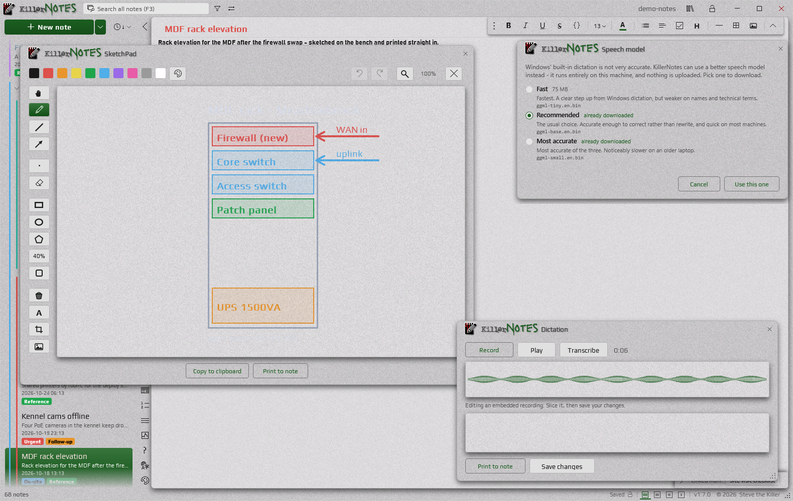
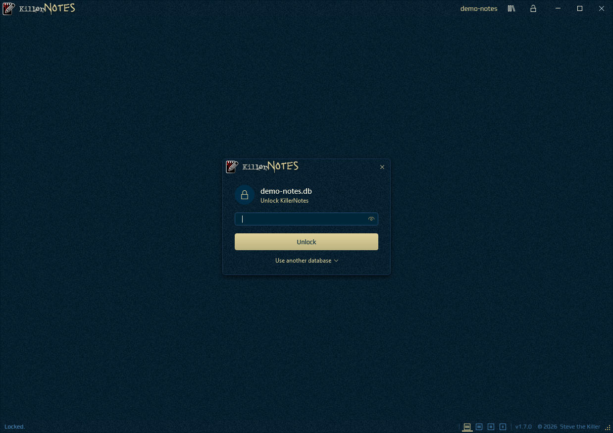

<p align="center">
  <a href="https://killernotes.net"></a>
</p>

Notes that keep up. A searchable, organized replacement for the 80-tab Notepad workflow:
rich notes with inline images and tables, instant full-text search, scheduled backups
with safe restore, and optional password protection for the whole database.

Target: .NET Framework 4.8, x64, WPF. Builds on Windows (MSBuild/Visual Studio).

See the [help page](https://killernotes.net/help.html) for workflows and shortcuts, and the [technical page](https://killernotes.net/technical.html) for storage, rendering, and security details.

## Features

- Rich text with images, tables, lists, checkboxes, spell check, custom fonts, title colors, and optional line numbers
- Markdown notes keep the familiar format bar and editor card, inserting source markers for bold, italic, strike, code, headings, lists, checkboxes, links, pipe tables, and rules
- Search titles, text, and tags as you type, with filters (tag:, group:, title:, after:, before:, created:, in:trash, "phrases") and saved searches; find and replace within a note or across notes
- Nested groups, colored tags, pinned notes, drag-and-drop ordering, templates, and daily notes
- Note and group cards keep their actions together, including duplicate (Alt+Shift+U), save as template (Alt+Shift+T), new note in group (Alt+Shift+H), and collapse all groups (Alt+Shift+Z)
- Group manager (Alt+Shift+O) opens a searchable group tree and sortable note list, with drag-and-drop filing and the same cards and undo as the sidebar
- The New note dropdown holds Markdown notes, templates, today's note, notes in a chosen group, and folder import; the sidebar export button (Alt+E) opens the folder picker directly
- Incoming and outgoing wikilinks, including links to notes that do not exist yet, plus a graph and heading outline
- Paragraph-level code highlighting and language-aware fenced Markdown code blocks
- Native Markdown and HTML preview with a Source, Rendered, and Split dropdown (F4 cycles views), following the active theme without a browser engine
- Autosave, saved cursor positions, version history, a 30-day trash, and scheduled backups that are checked before they count, warn while failing or overdue, and can be test-restored
- Lock now (Ctrl+Shift+U) closes a password notepad without quitting, and it locks itself when Windows locks or sleeps, or after an idle time you choose
- Quick note: a small capture box from the tray icon, the taskbar jump list or Win+Alt+N, saving to Inbox or today's note
- Import a folder of notes from a KillerNotes export, an Obsidian vault or another Markdown export, with a preview first; KillerNotes also appears under Open with for .md, .markdown, .txt, .rtf, .log, .html and .htm files
- Export all notes as Markdown into a dated folder with pictures, sketches and recordings beside each note and a report of anything not carried
- Multiple SQLite databases with optional SQLCipher AES-256 encryption; password-protected note (.knote) and database (.kndb) sharing
- Offline dictation (Ctrl+M): the speech engine and model download on first use, in the build for your processor, and transcription never leaves the machine; waveform editing, inline audio, and WAV or MP3 export
- Editable inline drawings with SketchPad (F7), floating images and recordings, and the Killculator (F9)
- Keyboard access throughout, contextual menu hints, an F1 keyboard map, and whole-app accessibility scaling
- CLI support for search, editing, sharing, export, templates, groups, tags, recovery, and backups; run `KillerNotes --cli --help` for commands
- Twenty languages and thirteen themes; eight accents on Dark, Light, Black, and 98SE give 41 looks

## Requirements

- Windows 10 or 11 (x64)
- No runtime install. Everything needed is inside the EXE (targets .NET Framework 4.8, which ships with every supported Windows release).

## Download

WinGet:

```powershell
winget install killernotes
```

Chocolatey:

```powershell
choco install killernotes
```

- Prebuilt binary: <https://github.com/SteveTheKiller/KillerNotes/releases/latest/download/KillerNotes.exe>
- Source (GPL3 corresponding source for this release): <https://github.com/SteveTheKiller/KillerNotes/releases/latest>

## Screenshots

<table>
<tr>
<td width="50%"><br><sub>Cyanotic: rich text, a system status table, its editing card, and nested client groups.</sub></td>
<td width="50%"><br><sub>98SE: the familiar tools insert Markdown source, including links and pipe tables.</sub></td>
</tr>
<tr>
<td width="50%"><br><sub>Group manager keeps nested groups and note filing together.</sub></td>
<td width="50%"><br><sub>Black, sidebar on the right: change color, tags, and group for several notes together.</sub></td>
</tr>
<tr>
<td width="50%"><br><sub>Light: a rack diagram, recording waveform, and offline speech model chooser.</sub></td>
<td width="50%"><br><sub>Unlock an encrypted notebook or choose another database.</sub></td>
</tr>
</table>

## Dependencies

| Package | Why |
|---------|-----|
| Microsoft.Data.Sqlite.Core | ADO.NET SQLite wrapper (managed) |
| SQLitePCLRaw.provider.e_sqlcipher | Managed P/Invoke shim to the SQLCipher native (static provider - the bundle's dynamic loader breaks under Costura) |
| SQLCipher + LibTomCrypt (vendored) | The encryption native itself, built from upstream source in `third_party/sqlcipher/` after the NuGet lib package line was deprecated |
| Markdig | Parses Markdown for native preview and rich text conversion (managed, MIT) |
| PolySharp | net48 polyfills for modern C# syntax (compile-time only) |
| libFLAC | Lossless storage for embedded recordings (native, BSD-3-Clause) |
| libmp3lame | MP3 export only, never storage (native, LGPL-2.1 - source shipped with every release) |
| whisper.cpp (+ ggml) | Offline speech recognition for dictation (native, MIT; downloaded on first use, not bundled) |

The three audio natives are cross-compiled from their upstream release tarballs rather than
taken from a mirror; the tarballs, hashes and exact build commands are in
`third_party/audio/README.md`. Speech models are downloaded on demand from whisper.cpp's model
repository on Hugging Face, and the whisper.cpp engine from this repository's `speech-engine-1.9.5`
release (hash-pinned in `Services/SpeechEngine.cs`); neither is bundled. All of it is optional at build time - with `third_party/audio/`
empty the app still builds and runs, storing recordings as WAV and transcribing with the
Windows engine.

Run `dotnet list package --vulnerable --include-transitive` as part of every release checklist.
Single-exe packaging: Costura.Fody embeds every managed dependency and a self-extracting
bootstrap carries the native e_sqlcipher.dll, so the release ships as one signed exe.
